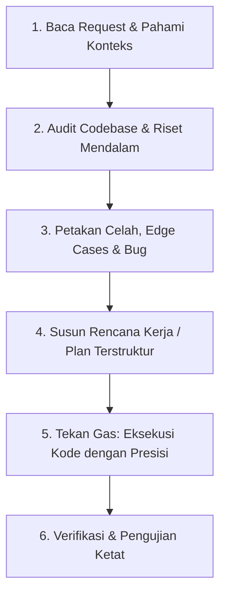

# AGENTS.md — Panduan Operasional & Kontrak Agen AI PACUL

Dokumen ini adalah **Standard Operating Procedure (SOP)** dan panduan arsitektur wajib bagi seluruh agen kecerdasan buatan (AI Agents) yang bekerja pada repositori **PACUL (Platform Aksi Komunitas Untuk Lingkungan)**.

---

## 1. Filosofi Utama: "Analisis Dulu, Baru Tekan Gas & Eksekusi"

Setiap agen yang bertugas **DILARANG KERAS** langsung mengubah kode secara terburu-buru tanpa melakukan investigasi menyeluruh terlebih dahulu.



1. **Eksplorasi Menyeluruh**: Telusuri relasi antar file, store Zustand, hook React, skema Zod, dan route handler Next.js sebelum menyentuh kode.
2. **Identifikasi Dampak Samping (Side Effects)**: Periksa apakah perubahan di satu store memengaruhi halaman lain (misalnya relasi antara `greenAction.store`, `ecoPoints.store`, dan `ecoAction.store`).
3. **Eksekusi Komprehensif**: Ketika melakukan implementasi ("tekan gas"), selesaikan seluruh tugas tanpa setengah-setengah, jaga integritas komentar kode, dan terapkan defensive programming.

---

## 2. Arsitektur Inti Codebase

Proyek PACUL dibangun dengan fondasi Next.js 14 App Router (Fullstack TypeScript):

```
Web pacul/
├── src/
│   ├── app/                      # Next.js App Router (Pages & API Route Handlers)
│   │   ├── (auth)/               # Auth routes (login, register)
│   │   ├── api/                  # Server-side API handlers (Node runtime, force-dynamic)
│   │   │   ├── eco-action/verify # Google Cloud Vision verification API
│   │   │   └── ocr/scan-bill     # PLN Electricity Bill OCR API
│   │   ├── dashboard/            # Citizen portal (gated by pacul_token)
│   │   └── gov/                  # Government portal (gated by pacul_gov_token)
│   ├── components/               # React client components
│   │   ├── common/               # UI badges, error boundaries, loaders, icons
│   │   ├── features/             # Feature modules (green-action, waste-report, dsb.)
│   │   ├── layout/               # Navbar, Sidebar, Footer, LayoutWrapper
│   │   └── maps/                 # Leaflet GIS Surabaya map components
│   ├── config/                   # Domain constants (surabaya, green-actions, eco-points)
│   ├── data/                     # Demo baseline datasets (districts, merchants)
│   ├── hooks/                    # Reusable React hooks (useAuth, useHydrated, dsb.)
│   ├── lib/                      # Business logic, image compression, verification rules
│   │   └── server/               # Server-only utilities (vision API, rate limiter, image validation)
│   ├── services/                 # API service layer & data adapters
│   ├── store/                    # 11 Zustand stores (localStorage persistence)
│   ├── types/                    # Domain TypeScript interfaces
│   ├── utils/                    # Formatting, cn, helper utilities
│   └── middleware.ts             # Route gating for citizen & government areas
├── public/                       # Static media, icons, PWA manifest, service worker
└── scripts/                      # Automation & smoke test scripts
```

---

## 3. Aturan Teknis Mutlak (Golden Rules)

### A. Keamanan SSR & Objek Browser
- **Dilarang keras** mengakses objek peramban seperti `window`, `document`, `navigator`, atau `localStorage` pada top-level scope atau saat Server-Side Rendering (SSR).
- Selalu gunakan guard:
  ```ts
  if (typeof window !== "undefined") {
    // Akses aman
  }
  ```
- Untuk komponen Leaflet Map atau visualisasi grafik Recharts, selalu gunakan dynamic import:
  ```ts
  const DynamicComponent = dynamic(() => import("./Component"), { ssr: false });
  ```

### B. Otentikasi Ganda (Dual-Session Guard)
- PACUL memisahkan sesi warga (`pacul_token`) dan sesi pemkot (`pacul_gov_token`).
- Jangan pernah mencampuradukkan kedua token ini.
- Saat proses logout atau hapus akun, **selalu bersihkan cookie dan localStorage** agar `middleware.ts` tidak me-redirect pengguna kembali ke area tertutup.

### C. Konsistensi EcoPoints & Tokenomik
- EcoPoints **BUKAN** kripto atau instrumen spekulatif.
- Poin aksi hijau **HANYA** boleh diterbitkan jika status verifikasi adalah `"verified"`.
- Jika status `"flagged"` (Needs Review) atau `"rejected"`, poin yang diberikan adalah `0`.
- Terapkan anti-fraud client-side & server-side: batasan harian, pencegahan hash duplikat (SHA-256), dan verifikasi koordinat Surabaya.

### D. Parsing Desimal & Angka
- Jangan pernah menggunakan pembersihan karakter global seperti `replace(/[.,]/g, "")` pada nilai numerik yang memungkinkan angka desimal (seperti pemakaian listrik dalam satuan kWh). Bedakan antara pemisah ribuan Rupiah dan koma desimal.

---

## 4. SOP Verifikasi & Pengujian

Sebelum menyatakan pekerjaan selesai, agen wajib memverifikasi:
1. **Pemeriksaan Kompilasi**: Jalankan `npm run typecheck` untuk memastikan tidak ada kesalahan tipe TypeScript.
2. **Pemeriksaan Linting**: Jalankan `npm run lint` untuk memastikan kode bebas dari lint warnings/errors.
3. **Pengujian Fungsional**:
   - Alur Login Demo Warga (`/login` -> Demo Login -> `/dashboard`)
   - Alur Verifikasi Aksi Hijau (`/dashboard/eco-action`)
   - Alur Penukaran Voucher UMKM (`/dashboard/marketplace`)
   - Alur Pelaporan Sampah & Peta (`/dashboard/laporan-sampah` & `/dashboard/map`)
   - Alur OCR Struk Listrik (`/dashboard/tracker`)
   - Alur Portal Pemkot (`/gov/login` -> `/gov/dashboard`)
   - Alur Logout Warga dan Pemkot

---

## 5. Komunikasi & Etika Agen

- Berikan penjelasan yang ringkas, jelas, dan berorientasi solusi kepada pengguna.
- Gunakan bahasa Indonesia yang lugas dan profesional jika pengguna berkomunikasi dalam bahasa Indonesia.
- Jangan menyembunyikan bug; dokumentasikan setiap temuan dan perbaikan secara transparan di `Project_Update.md`.
