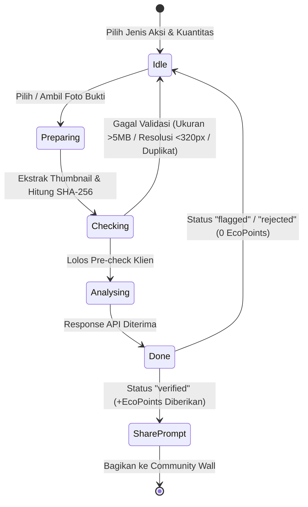

# Frontend Flow Contract — Spesifikasi Alur Antarmuka PACUL

Dokumen ini mendefinisikan **kontrak alur pengguna (user flow)**, **state machine navigasi**, **gating otentikasi**, dan **perilaku komponen antarmuka** di seluruh aplikasi frontend PACUL.

---

## 1. Peta Rute & Aturan Gating (Route Tree & Middleware Contract)

Aplikasi memiliki 4 kelompok rute utama:

```
[Rute Publik]
 ├── /                      -> Halaman Depan (Landing Page)
 ├── /demo                  -> Panduan Eksplorasi Demo Juri
 ├── /manifest.json         -> PWA Web Manifest
 └── /sw.js                 -> PWA Service Worker

[Rute Autentikasi Warga]
 ├── /login                 -> Masuk Akun Warga (Tersedia Tombol Demo Judge)
 └── /register              -> Pendaftaran Akun Warga Baru

[Rute Terlindungi: Dashboard Warga (Gated: pacul_token)]
 ├── /dashboard             -> Ringkasan Aktivitas, KPI, Tantangan Aktif
 ├── /dashboard/eco-action  -> Verifikasi Aksi Hijau AI, Tantangan & Leaderboard
 ├── /dashboard/marketplace -> Bursa Pasar Hijau (Penukaran Voucher UMKM)
 ├── /dashboard/map         -> Peta Dampak Geospasial 31 Kecamatan Surabaya
 ├── /dashboard/laporan-sampah -> Pelaporan Titik Sampah Publik & Tracking
 ├── /dashboard/tracker     -> Carbon Tracker & OCR Struk Listrik PLN
 ├── /dashboard/step-tracker-> Pelacak Langkah Kaki Hijau (Sensor / Simulasi)
 ├── /dashboard/collaboration-> Community Action Wall (Feed Warga)
 ├── /dashboard/profile     -> Profil Pengguna, Statistik & Badges
 └── /dashboard/profile/edit-> Pengaturan Profil & Preferensi

[Rute Terlindungi: Portal Pemkot (Gated: pacul_gov_token)]
 ├── /gov/login             -> Masuk Khusus Petugas Pemkot / DLH Surabaya
 └── /gov/dashboard         -> Portal Tanggap Sampah, Analitik & Ekspor CSV
```

### Logika Middleware (`src/middleware.ts`)

| Kondisi Request | Aksi Middleware |
|---|---|
| Mengakses `/dashboard/*` **tanpa** cookie `pacul_token` | Redirect ke `/login?next={pathname}` |
| Mengakses `/gov/*` (kecuali `/gov/login`) **tanpa** cookie `pacul_gov_token` | Redirect ke `/gov/login` |
| Mengakses `/login` atau `/register` **dengan** cookie `pacul_token` aktif | Redirect ke `/dashboard` |
| Mengakses `/gov/login` **dengan** cookie `pacul_gov_token` aktif | Redirect ke `/gov/dashboard` |
| Sesi warga mencoba membuka `/gov/dashboard` | Ditolak oleh middleware (diarahkan ke `/gov/login`) |

---

## 2. State Machine Alur Pengguna (Feature Flow Contracts)

### A. Alur Verifikasi Aksi Hijau (`/dashboard/eco-action`)



1. **Pre-check**: Memeriksa format file magic bytes, ukuran (maks. 5 MB), resolusi minimum (320 px), dan mencegah pengiriman foto yang sama yang sudah ada di riwayat pengguna (SHA-256 hash).
2. **AI Analysis**: Memanggil `POST /api/eco-action/verify`.
3. **Konsekuensi**:
   - Jika `verified`: EcoPoints langsung ditambahkan ke `ecoPoints.store`, progres tantangan terkait di `ecoAction.store` dimajukan, dan pengguna dapat membagikan aksinya ke feed komunitas dengan lencana *Verified Action*.
   - Jika `flagged` (Needs Review) atau `rejected`: Poin tidak diterbitkan, alasan penolakan/tinjauan ditampilkan secara jelas.

---

### B. Alur Bursa Pasar Hijau & Penukaran Voucher (`/dashboard/marketplace`)

1. **Pilih Reward**: Menampilkan daftar voucher UMKM mitra Surabaya (kategori Kuliner, Belanja, Servis, Produk Daur Ulang).
2. **Validasi Saldo**:
   - Jika `balance < reward.ecoPointsCost`: Tombol disabled dengan pesan sisa poin yang dibutuhkan.
   - Jika `hasActiveVoucher`: Pengguna dicegah menukarkan voucher yang sama sebelum voucher aktif sebelumnya terpakai atau kedaluwarsa.
3. **Eksekusi Penukaran**:
   - Poin dikurangi dari `ecoPoints.store` dengan transaksi bertipe `redeem`.
   - Stok reward di `voucher.store` dikurangi 1.
   - Kode voucher unik dihasilkan (`PCL-XXX-XXX`) lengkap dengan data QR string.
4. **Penggunaan di Kasir**:
   - Tombol *"Tandai Terpakai"* mengubah status voucher menjadi `used` dan mencatat `usedAt`.
   - Voucher yang melewati `expiresAt` secara otomatis berstatus `expired`.

---

### C. Alur Pelaporan Sampah Warga (`/dashboard/laporan-sampah`)

Formulir 3-langkah (Wizard Step Bar):
1. **Langkah 1 (Lokasi)**:
   - Pengguna dapat mengetuk peta Leaflet atau menggunakan tombol *"Gunakan Lokasi Saya"*.
   - Jika pengguna memilih kecamatan dari dropdown tanpa mengetuk peta, sistem secara otomatis memasang titik koordinat pada centroid kecamatan tersebut.
   - Validasi: `lat !== null && lng !== null && kecamatanId !== ""`.
2. **Langkah 2 (Detail Laporan)**:
   - Judul laporan: minimal 10 karakter.
   - Kategori (Sampah Menumpuk, TPS Liar, Sampah Sungai, Sampah Jalan, Limbah B3).
   - Tingkat Urgensi (Rendah, Sedang, Tinggi, Kritis).
   - Deskripsi: minimal 20 karakter.
3. **Langkah 3 (Foto Bukti)**:
   - Unggah minimal 1 foto (maks. 3 foto).
   - Foto dikompresi di sisi klien menjadi data URL JPEG bebas EXIF (maks. 1600 px).
4. **Pemberian Reward**:
   - Maksimal 2 laporan yang mendapatkan reward per hari (+30 EcoPoints/laporan).
   - Laporan ke-3 dan seterusnya tetap dapat dikirim untuk kepentingan publik tanpa tambahan poin (mencegah spamming).

---

### D. Alur OCR Struk Listrik PLN (`/dashboard/tracker`)

1. **Input Bukti**: Unggah file foto struk pembayaran listrik PLN atau tangkapan kamera langsung.
2. **Pemrosesan OCR**:
   - Gambar dikirim ke `POST /api/ocr/scan-bill`.
   - Algoritma mengekstrak No. Pelanggan, Nama, Daya VA, Pemakaian (kWh), dan Total Tagihan (Rp).
   - Nilai kWh diparsing dengan dukungan desimal (`allowDecimal: true`).
3. **Review & Simpan**:
   - Pengguna dapat mengoreksi angka kWh dan tagihan sebelum disimpan.
   - Reward harian: +15 EcoPoints untuk pencatatan pertama di hari tersebut.

---

### E. Alur Pelacak Langkah Kaki (`/dashboard/step-tracker`)

1. **Deteksi Perangkat**:
   - Ponsel (Mobile): Meminta izin sensor `devicemotion`. Membutuhkan koneksi HTTPS jika di iOS Safari.
   - Komputer (Desktop): Otomatis menampilkan banner dan beralih ke *Simulation Mode*.
2. **Penghitungan**:
   - Mengelompokkan langkah per jam (6 pagi - 10 malam).
   - Milestone Harian: 1.000 langkah (+10 EcoPoints), 5.000 langkah (+25 EcoPoints), 10.000 langkah (+50 EcoPoints).
   - Langkah simulasi tidak menerbitkan EcoPoints (khusus demonstrasi interaktif).

---

## 3. Kontrak State Management (Zustand Stores)

| Store | Nama Penyimpanan LocalStorage | Entitas Utama yang Dikelola |
|---|---|---|
| `auth.store` | `pacul-auth` | Sesi warga, nama, email, avatar, preferensi |
| `govAuth.store` | `pacul-gov-auth` | Sesi petugas DLH/Pemkot, unit dinas |
| `ecoPoints.store` | `pacul-ecopoints` | Saldo EcoPoints, poin seumur hidup, buku besar transaksi |
| `greenAction.store` | `pacul-green-actions` | Daftar riwayat aksi hijau terverifikasi pengguna |
| `ecoAction.store` | `pacul-challenges` | Tantangan komunitas (target aksi, progres, reward) |
| `voucher.store` | `pacul-bursa-pasar-hijau` | Katalog reward UMKM, daftar voucher tersimpan |
| `wasteReport.store` | `pacul-waste-reports` | Daftar laporan sampah publik, histori status respon |
| `collaboration.store` | `pacul-community` | Postingan feed komunitas, aksi terverifikasi dibagikan |
| `stepTracker.store` | `pacul-step-tracker` | Rekap langkah per jam, riwayat mingguan, milestone hari ini |
| `judgeGuide.store` | `pacul-judge-guide` | Status checklist walkthrough panduan juri lomba |

---

## 4. Standar Notifikasi & Feedback UI (Sonner Toast Rules)

1. **Sukses**: `toast.success("Pesan aksi berhasil")`
   - Warna aksen hijau botani `#2D5F3F`. Digunakan saat verifikasi lolos, penukaran voucher berhasil, laporan terkirim, atau login sukses.
2. **Peringatan / Info**: `toast.info("Informasi status")`
   - Digunakan saat foto perlu ditinjau (*Needs Review*), atau pengguna mencapai batas klaim poin harian.
3. **Error**: `toast.error("Pesan kegagalan")`
   - Digunakan saat validasi file gagal, koordinat di luar Surabaya, atau kredensial login salah.
