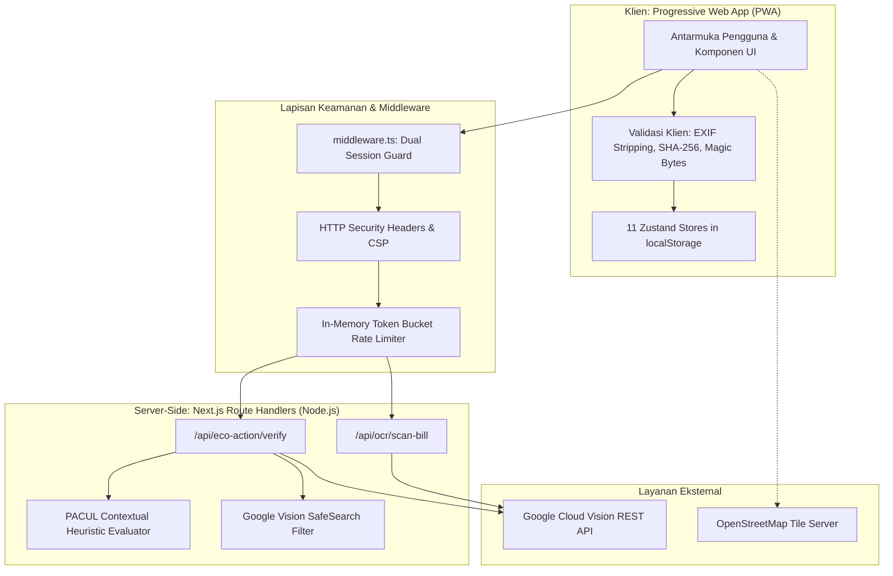
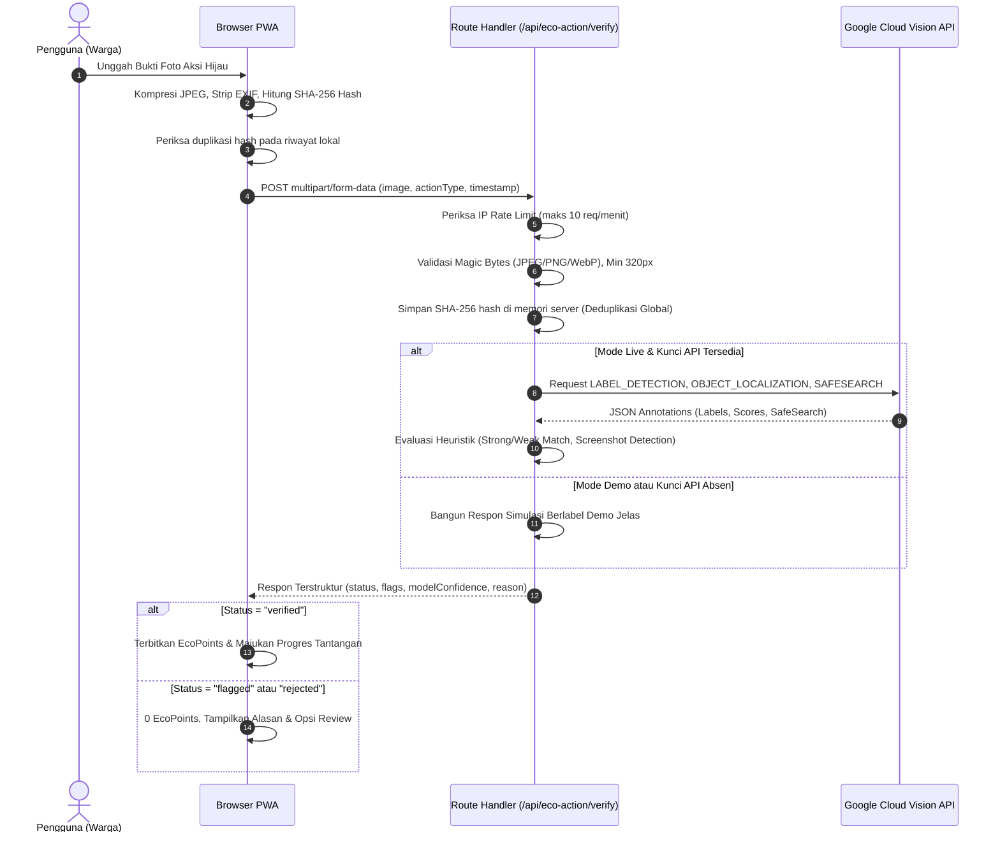

# system.md — Spesifikasi Arsitektur Sistem PACUL

Dokumen ini memuat detail teknis arsitektur sistem, alur pemrosesan data, integrasi kecerdasan buatan, model keamanan, dan mitigasi risiko teknis untuk **PACUL (Platform Aksi Komunitas Untuk Lingkungan)**.

---

## 1. Topologi Arsitektur Sistem

PACUL mengadopsi pola arsitektur **Hybrid Client-Edge/Node Fullstack** menggunakan Next.js 14 App Router:

---

## 2. Saluran Pemrosesan Verifikasi Gambar (AI Verification Pipeline)

Alur verifikasi aksi hijau dirancang dengan prinsip **fail-safe & transparent fallback**:

---

## 3. Mesin Evaluasi Heuristik & Formula Skor

Evaluasi label Google Vision pada `src/lib/verification/evaluate.ts` menggunakan pembobotan kata kunci kontekstual:

$$\text{Score} = \min\left(1.0, \sum_{l \in L_{\text{strong}}} \text{score}(l) + 0.6 \sum_{w \in L_{\text{weak}}} \text{score}(w) + \text{Corroboration Bonus}\right)$$

### Aturan Keputusan Status:
1. **Verified**: $\text{Score} \ge 0.75$ dan tidak terdeteksi indikasi tangkapan layar (*screenshot*) atau konten vulgar.
2. **Action Mismatch**: Jika aksi yang dipilih mendapatkan skor $< 0.50$ namun terdapat jenis aksi hijau lain yang mendapatkan skor $\ge 0.75$, sistem menolak (*rejected*) dan memberikan saran aksi yang sesuai (*suggested action*).
3. **Flagged (Needs Review)**: Skor $0.50 \le \text{Score} < 0.75$, atau jika foto terdeteksi berusia $> 72$ jam (*stale evidence*) atau hash foto telah digunakan sebelumnya (*duplicate image*).
4. **Rejected**: Skor $< 0.50$ atau konten terdeteksi mengandung unsur kekerasan/dewasa pada SafeSearch (kemungkinan `LIKELY` atau `VERY_LIKELY`).

---

## 4. Model Keamanan & Privasi (Security & Privacy Model)

| Vektor Keamanan | Mekanisme Proteksi yang Diterapkan |
|---|---|
| **Secret Management** | `GOOGLE_VISION_API_KEY` dijaga di sisi server menggunakan guard `import "server-only"`. Kunci tidak pernah diekspos ke klien. |
| **Content Security Policy (CSP)** | Diatur pada `next.config.js`: `default-src 'self'`, `frame-ancestors 'none'`, `object-src 'none'`, pemblokiran `unsafe-eval` di production. |
| **Pemisahan Sesi (Dual Cookie)** | Sesi warga menggunakan `pacul_token` (`SameSite=Lax`), sesi pemkot menggunakan `pacul_gov_token` (`SameSite=Strict`, 1 hari). Sesi dipisahkan secara fisik. |
| **Privasi Lokasi (Spatial Obfuscation)** | Koordinat GPS diperkecil (*snapped*) menjadi ID kecamatan di sisi peramban sebelum disimpan. Peta publik hanya menampilkan agregat distrik. |
| **Sanitasi Ekspor Data** | Ekspor CSV pada dashboard pemkot mengutip seluruh field dan menetralkan karakter injeksi formula spreadsheet (`=`, `+`, `-`, `@`). |
| **Perlindungan EXIF** | Metadata sensitif kamera (termasuk tag GPS geolokasi pribadi) dihapus di kanvas peramban sebelum dikirim ke server. |
| **Pembatasan Laju (Rate Limiting)** | Rate limiter berbasis in-memory sliding window membatasi akses verifikasi maksimal 10 request/menit per alamat IP. |
